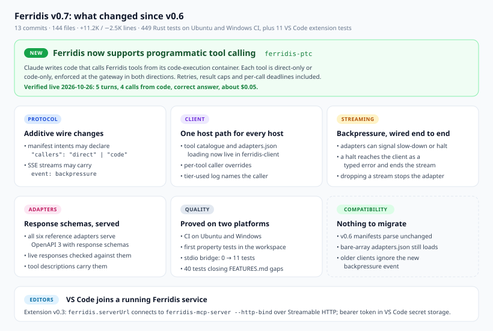
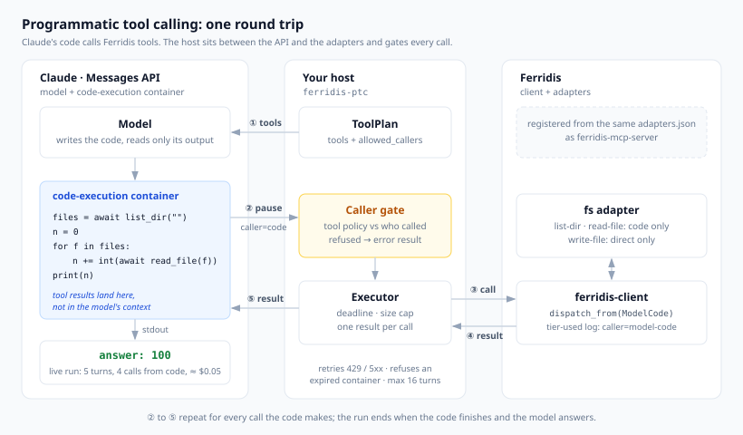
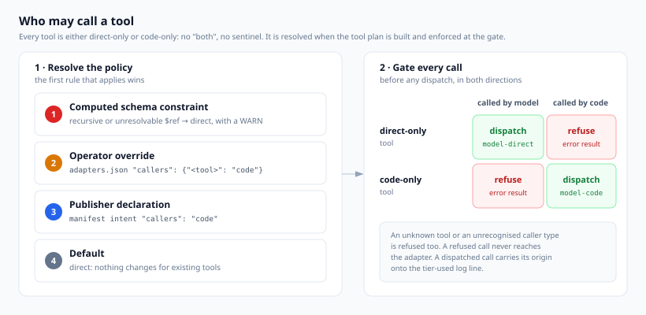
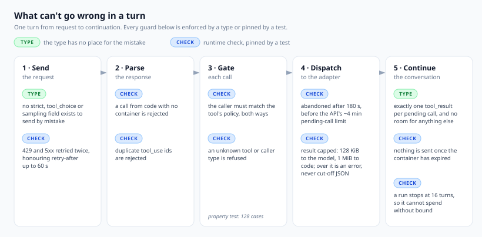

# Ferridis v0.7: programmatic tool calling

> **Released 2026-10-26** as tag `v0.7.0`; every crate in the workspace is now versioned `0.7.0`. Everything here is built, tested on Ubuntu and Windows CI, and, for the headline feature, verified once against the live Claude API.

**Ferridis now supports programmatic tool calling.** Claude can call Ferridis tools from code it writes and runs, not only one call at a time from the conversation. That is the headline of v0.7. The release also lets VS Code connect to a Ferridis service that is already running, wires backpressure end to end, and adds response schemas to every reference adapter.

Most of the cost of an AI tool call is not the call. It is everything that comes back. A directory listing, a calendar week, a search result: each lands in the model's context, is paid for in tokens, and is re-read on every turn after.

v0.7 lets Claude stop doing that. With **programmatic tool calling**, Claude writes a short program, the program calls Ferridis tools from Claude's code-execution container, and only what the program prints reaches the model. The intermediate data stays in the container.

Ferridis already knew what a tool was, who published it and how to reach it. What it needed was an opinion on *who may call it*. v0.7 adds that opinion, and enforces it at the gateway.



## Contents

- [How it works](#how-it-works)
- [Who may call a tool](#who-may-call-a-tool)
- [Using it](#using-it)
- [What can't go wrong in a turn](#what-cant-go-wrong-in-a-turn)
- [Verified live](#verified-live)
- [Everything else in v0.7](#everything-else-in-v07)
- [Compatibility](#compatibility)
- [Known limits](#known-limits)

## How it works



The new crate, `ferridis-ptc`, is a host. It sits between the Claude Messages API and your Ferridis adapters, and it is the only party that talks to both.

1. **Tools.** The host turns the Ferridis tool catalogue into Messages API tools. Each tool carries an `allowed_callers` list taken from its caller policy.
2. **Pause.** Claude writes code. When the code calls a tool, the API pauses the turn and hands the host a `tool_use` block that says who made the call: the model directly, or code in the container.
3. **Call.** The host checks the caller against the tool's policy. An allowed call is dispatched through the same `ferridis-client` every other Ferridis host uses, and the caller is written onto the tier-used log line.
4. **Result.** The adapter answers.
5. **Back to the code.** The host sends the result back as a `tool_result`. It goes to the program, not to the model's context.

Steps 2 to 5 repeat for every call the program makes. When the program finishes, the model reads its output and answers.

The host speaks to the Messages API over the workspace's existing `reqwest` client. No SDK was added.

## Who may call a tool



Every tool is either **direct-only** or **code-only**. There is no "both" and no sentinel value: the policy is a two-variant enum, so an in-between state cannot be written down.

The policy comes from the first of these that applies:

| Rank | Source | Who sets it | Example |
|---|---|---|---|
| 1 | Computed constraint | Ferridis | A tool whose input schema has a recursive or unresolvable `$ref` cannot be called from code, so it drops to direct with a WARN naming it |
| 2 | Operator override | Whoever runs the host | `adapters.json` → `"callers": { "<tool>": "code" }` |
| 3 | Publisher declaration | The adapter's author | manifest intent → `"callers": "code"` |
| 4 | Default | — | direct, so every existing tool behaves exactly as before |

A publisher declares it per intent in the manifest:

```json
{
  "intents": [
    { "verb": "list-events", "callers": "code" },
    "read-event"
  ]
}
```

An operator overrides it in `adapters.json`, which gains an object form beside the original bare array:

```json
{
  "adapters": [
    {
      "capability": "ferridis://public.ferridis.io/ferridis/fs@v1",
      "manifestUrl": "http://127.0.0.1:7821/manifest.json",
      "baseUrl": "http://127.0.0.1:7821/"
    }
  ],
  "callers": {
    "ferridis_ferridis_fs_v1_list_dir": "code",
    "ferridis_ferridis_fs_v1_read_file": "code"
  }
}
```

A misspelt top-level key is a load error, not a silently ignored override. An override that names no registered tool is logged as a warning, because one offline adapter should not stop the host starting.

The gate runs **before** any dispatch and **in both directions**. Code calling a direct-only tool is refused. So is the model calling a code-only tool directly, an unknown tool, or a caller type the gate does not recognise. A refused call gets an error result and never reaches the adapter.

## Using it

Run one conversation against the live API with the bundled example:

```bash
cd rust
ANTHROPIC_API_KEY=... cargo run -p ferridis-ptc --example ptc_run -- \
    adapters.json "Read every file under the root and total their line counts."
```

A key that is not scoped to a workspace also needs `ANTHROPIC_WORKSPACE_ID`. The example prints each tool's policy and where it came from, every code run, the call counts and the token usage.

In your own host, the whole loop is a few lines:

```rust
let file = AdaptersFile::load(Path::new("adapters.json"))?;
let client = Client::ephemeral();
let (sources, _failures) = register_adapters(&client, file.adapters()).await;

let plan = ToolPlan::build(&Catalogue::from_sources(&sources), file.caller_overrides());
let conversation = Conversation::new(ModelId::default_model(), MaxTokens::default(), plan.tool_set());
let executor = Executor::new(plan, client);

let outcome = run(
    &PtcClient::new(ApiKey::from_env()?),
    &executor,
    conversation,
    UserPrompt::new("Add up the numbers in every file.")?,
    MaxTurns::default(),
)
.await?;
println!("{}", outcome.final_turn().text());
```

Defaults you can change: `PtcClient::with_retry`, `with_workspace`, `with_endpoint`; `Executor::with_max_result` (per caller) and `with_deadline`; `MaxTurns::new`. The host needs a tokio runtime with time enabled, which `#[tokio::main]` provides.

## What can't go wrong in a turn



Ferridis is built on one rule: if a mistake can be made impossible at compile time, it must be. Where it cannot, a runtime check stands in its place and a test pins it.

Two of the guards above are types:

- **The request has no field to send by mistake.** The tool definition type has no `strict` field, which the API rejects alongside programmatic calling. The request type has no `tool_choice` or sampling fields either. Ferridis cannot send any of them, because there is nowhere to put them.
- **A continuation answers every pending call exactly once, with nothing else.** A paused turn is a typestate, `PendingCalls<WithContainer | NoContainer>`. Its only way forward takes one result per pending call id, and the message it builds has no place for a text block.

The rest are runtime checks, each pinned by a test. The new ones in this release were each checked by deliberately cutting the guard and watching its test fail:

| Guard | Default | Why |
|---|---|---|
| Retry | 2 retries on `429`, any `5xx` and failed connections; `retry-after` honoured up to 60 s | A transient failure mid-conversation should not lose a live container. Timeouts are not retried, because the API may already have processed the request |
| Result size cap | 128 KiB for results the model reads, 1 MiB for results returned to code | An oversized result becomes an error naming its size. It is never truncated, because cut-off JSON would not parse in the program that asked for it |
| Per-call deadline | 180 s | Answers before the API's roughly four-minute limit on a paused call from code. The error says the call may still have taken effect, because it may have |
| Container expiry | from the API | Nothing is sent once the container has expired; the API would reject it anyway |
| Turn limit | 16 | A model that keeps calling tools cannot spend without bound |

## Verified live

The replay tests use responses written from the API documentation. The live smoke test is the check that the documentation matches the wire. It ran once, on 2026-10-26:

| | |
|---|---|
| Task | Code lists a folder through the filesystem adapter, reads the three files and adds up the numbers in them |
| Model | `claude-opus-5-5` |
| Turns | 5 |
| Calls made from code | 4 (one listing, three reads) |
| Calls refused | 0 |
| Answer | `100` (17 + 25 + 58) |
| Tokens | 10,835 input, 215 output |
| Cost | about $0.05 |
| Wall time | 10 s |

The first attempt found one real bug: a key not scoped to a workspace has to name one on every request. `ferridis-ptc` now sends `anthropic-workspace-id` when one is configured.

The live test is `#[ignore]`d and gated behind `FERRIDIS_PTC_LIVE=1`, so neither `cargo test` nor CI spends anything:

```bash
FERRIDIS_PTC_LIVE=1 ANTHROPIC_API_KEY=... \
    cargo test -p ferridis-ptc --test live_smoke -- --ignored --nocapture
```

## Everything else in v0.7

**VS Code connects to a running Ferridis service (extension v0.3).** Until now the extension always launched a private copy of `ferridis-mcp-server` for the editor. It can now join one that is already running, such as a Windows service or a systemd unit started with `--http-bind`, over MCP Streamable HTTP. VS Code then shares that one federation rather than starting a second copy, which would lose any adapter that needs the service's privileges.

```json
{
  "ferridis.serverUrl": "http://127.0.0.1:7820/mcp"
}
```

Then run **Ferridis: Set Service Token** and paste the bearer token the service was started with (`--bearer-token` or `FERRIDIS_MCP_BEARER`). This is the service's own token, not an Anthropic API key. It is kept in VS Code's secret storage, attached only when the server starts, and never written to settings. Plain `http` is accepted only for a loopback address, and a malformed URL is an error, never a silent fall-back to the stdio mode. Without `serverUrl` the extension behaves exactly as v0.2 did.

**Backpressure, wired end to end.** The `BackpressureSignal` types shipped in v0.4 but nothing used them. Now an adapter can tag stream chunks, and the SDK puts the signal on the wire only when it changes:

```text
event: backpressure
data: {"signal":"slow-down"}
```

A `halt` ends the stream, and the client surfaces it as a typed `ClientError::StreamHalted`. A slow-down is reported through tracing.

**Cancellation, proven.** When a consumer drops a stream, the connection closes, the SDK drops the adapter's stream, and anything the adapter tied to it (a child process, for instance) is released. An end-to-end test drives that whole path.

**Response schemas from every adapter.** All six reference adapters serve OpenAPI 3 with a response schema for each request intent, and each adapter's test suite checks live responses against it. Tool descriptions, in the MCP server and in `ferridis-ptc`, now end with that schema, so a model knows the shape of what it will get back before it calls. Schemas still load lazily: `Client::register` never fetches the OpenAPI document, and a host that wants to describe its tools up front asks for it explicitly, as the MCP server and `ferridis-ptc` do.

**One host path for every host.** Tool naming, descriptions and `adapters.json` loading moved out of the MCP server binary into `ferridis-client` (`catalogue` and `adapters` modules). The MCP server and `ferridis-ptc` now register tools the same way, and `dispatch_from` writes the caller (`host`, `model-direct` or `model-code`) onto every tier-used log line.

**Quality.**
- CI runs format, lint and tests on Ubuntu and Windows.
- The workspace's first property tests landed: the intent-verb and capability-reference parsers, the SSE wire parser, and two for PTC (one result per pending call; a refused call never reaches the adapter).
- 40 tests closed the remaining gaps in [FEATURES.md](./FEATURES.md), including taking `ferridis-stdio-bridge` from 0 tests to 11.
- 449 Rust workspace tests pass today, plus 11 for the VS Code extension's settings and token handling (`npm test`).

## Compatibility

Nothing to migrate.

- **Manifests:** `callers` is optional, and a v0.6 manifest parses unchanged. An unknown `callers` value such as `"both"` is rejected rather than read as undeclared.
- **`adapters.json`:** the bare-array form still loads. The object form is new and opt-in.
- **Streaming:** clients older than v0.7 ignore the `backpressure` event, as SSE clients do with any event they do not know.
- **Tools:** every tool defaults to direct, so hosts that never call code see no change.
- **VS Code:** extension v0.3 needs VS Code 1.101 or later, for the MCP server definition provider. Existing `ferridis.serverPath` setups keep working unchanged.

## Known limits

Said plainly, so nobody has to find them:

- **The live test covers one scenario.** Refusals, expired containers, retries, result caps and deadlines are pinned by replay and unit tests only. A `429` or `529` cannot be produced on demand.
- **Server-side refusal fallback is not enabled.** If the model declines, the run ends. Fallback changes which model answers, which is the operator's call, not a library default.
- **The result cap bounds what is sent, not what is held.** The adapter's whole response is in memory before it is measured.
- **`ferridis-mcp-server` still speaks MCP 2024-11-05.** Moving it to a spec with `outputSchema` and `structuredContent` is a separate piece of work.
- **Programmatic tool calling is a Messages API feature, so it runs through `ferridis-ptc`.** MCP clients, including the editors, still call Ferridis tools one at a time. The MCP server and `ferridis-ptc` give each tool the same name, so a policy written for one reads correctly for the other. *Since the v0.7.0 tag:* `ferridis-mcp-server --ptc-api-key-file` offers a whole programmatic run to MCP clients as one tool, `ferridis_ptc_run`; see [INSTALL.md](./INSTALL.md#programmatic-tool-calling-for-mcp-clients).
- **The editor extensions are partly verified by hand.** The VS Code extension's settings parsing and token checks have 11 tests. Its MCP provider, secret storage and the Zed extension are still checked manually.

The full per-feature contract, with the test that enforces each row, is in [FEATURES.md](./FEATURES.md). The design decisions behind this release, including the alternatives rejected, are in the decisions log in [architecture.md](./architecture.md).

---

Ferridis is maintained by **George Andrikopoulos**, and named for [Alexandros Ferridis](./about-the-name.md). Apache 2.0.
